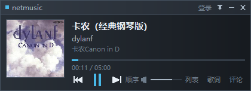
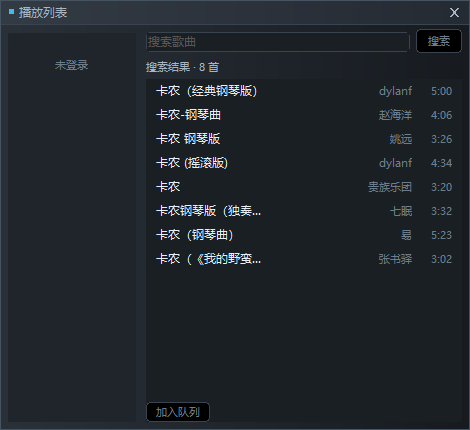
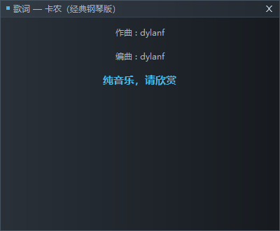

# netmusic — 50MB 级的网易云音乐桌面播放器（Windows 7 / 10 / 11）

一个**手写 Win32 + 纯 Go** 的网易云音乐桌面客户端，外观参考千千静听的主控窗口（暗色窄条 + 独立播放列表 / 歌词 / 评论窗口）。

设计上只有一个优先级：**常驻内存**。所以这里没有 WebView、没有 Qt/GTK、没有 FFmpeg、没有 cgo、没有 GDI+。

> **目标运行环境：Windows 7（32 位为主）+ 2GB 内存 + 弱 CPU。**
> 产物用 **Go 1.20** 编译（Go 1.21+ 运行时已不支持 Win7）。32 位版可同时跑在 32/64 位 Windows 上，建议优先分发 32 位版。

```
────────────────────────────────────────────────
 ■ netmusic                未登录 ▣ ─ ✕
 ┌────────┐  卡农（经典钢琴版）
 │  封面  │  dylanf
 │        │  卡农 Canon in D
 └────────┘  ▁▁▁▁▁▁▁▁▁▁▁▁▁▁▁▁▁▁▁▁▁  01:12 / 05:00
             ⏮  ⏸  ⏭   顺序  🔊 ▁▁▁   列表 歌词 评论
────────────────────────────────────────────────
```

| 主控窗口 | 播放列表 |
|---|---|
|  |  |

| 歌词 | 评论 | 登录 |
|---|---|---|
|  |  |  |

> 截图为实际运行画面（程序内 `PrintWindow` 抓取），非设计稿。

## 一、硬指标达成情况

| 指标 | 要求 | 实测（32 位，Win7 目标） | 实测（64 位） | 结论 |
|---|---|---|---|---|
| 常驻内存 RSS（全功能） | < 100 MB | **36.3 MB** | 39.4 MB | ✅ 在 50MB 目标内 |
| 评论模块增量 | < 20 MB（否则降级） | **+0.84 MB** | +1.26 MB | ✅ 未触发降级 |
| 单进程 GUI | 必须 | ✅ 一个进程 5 个窗口 | ✅ | ✅ |
| 原生控件 / 轻量绑定 | 禁止 WebView | ✅ user32/gdi32/comctl32 直调 | ✅ | ✅ |
| 系统音频 API | 优先 WASAPI | ✅ WASAPI 共享模式（手写 COM） | ✅ | ✅ |
| 无大型多媒体框架 | 禁止 FFmpeg 全量 | ✅ 仅纯 Go MP3 解码 | ✅ | ✅ |
| 产物大小 | — | **5.51 MB** 单文件 | 5.67 MB | ✅ |

同机对照：官方网易云音乐客户端（cloudmusic.exe）当时占用 **333 MB**，本项目 **36 MB**。

## 二、内存实测记录

测量方式：进程内 `GetProcessMemoryInfo`（PSAPI）+ `runtime.ReadMemStats` 每阶段采样，外部 `Get-Process` 复核。
**不是估算**，可用 `netmusic.exe -selftest -stage N` 复现。

### 2.1 分阶段实测（32 位产物）

| 阶段 | 场景 | RSS (WS) | 私有字节 | Go Heap | Go Sys | GDI | USER |
|---|---|---|---|---|---|---|---|
| stage0 | 主控窗口 + 登录窗口（二维码已渲染） | 21.15 MB | 9.62 MB | 1.86 MB | 5.64 MB | 35 | 22 |
| stage1 | + 播放列表窗口 + 搜索 8 首结果 | 22.29 MB | 10.79 MB | 2.15 MB | 9.78 MB | 44 | 25 |
| stage2 | + 正在播放（音频 + 封面 + 歌词） | 34.20 MB | 19.93 MB | 8.96 MB | 18.41 MB | 44 | 26 |
| stage3 | + 歌词窗口 | 35.42 MB | 20.94 MB | 6.06 MB | 18.41 MB | 46 | 27 |
| stage4 | **+ 评论窗口（热门 15 条）** | 36.26 MB | 21.48 MB | 6.37 MB | 18.41 MB | 48 | 27 |
| stage5 | **+ 评论窗口（最新第 2 页）** | 36.24 MB | 21.46 MB | 6.58 MB | 18.41 MB | 48 | 26 |

### 2.2 评论开启前 / 后对比（32 位）

| | 评论前 (stage3) | 评论后 (stage4) | 增量 |
|---|---|---|---|
| RSS | 35.42 MB | 36.26 MB | **+0.84 MB** |
| Go Heap | 6.06 MB | 6.37 MB | +0.31 MB |
| 私有字节 | 20.94 MB | 21.48 MB | +0.54 MB |
| GDI 对象 | 46 | 48 | +2 |

翻到第 2 页（stage5）RSS 反而 -0.02MB，不再增长 ⇒ **翻页不累积内存**。

64 位产物同样跑过一遍：stage3 38.01 → stage4 39.27，评论增量 **+1.26 MB**（见 `docs/03-memory.md`）。

### 2.3 长跑稳定性（`-soak 10`，10 次切歌，全部窗口开启，32 位）

```
soak 0 : WS=34.18MB  Heap= 7.72MB  GDI=46  USER=28
soak 1 : WS=34.39MB  Heap= 5.53MB  GDI=46  USER=25
soak 2 : WS=37.29MB  Heap= 9.88MB  GDI=48  USER=25
soak 3 : WS=36.01MB  Heap= 7.10MB  GDI=48  USER=25
soak 4 : WS=30.93MB  Heap= 2.84MB  GDI=48  USER=25
soak 5 : WS=36.73MB  Heap= 6.36MB  GDI=48  USER=25
soak 6 : WS=34.21MB  Heap= 4.62MB  GDI=48  USER=25
soak 7 : WS=34.72MB  Heap= 5.71MB  GDI=48  USER=25
soak 8 : WS=41.66MB  Heap= 9.78MB  GDI=48  USER=25
soak 9 : WS=32.07MB  Heap= 4.49MB  GDI=48  USER=25
soak10 : WS=33.45MB  Heap= 3.88MB  GDI=48  USER=25
```

- RSS 在 **30.9 – 41.7 MB** 之间随 GC 波动，**无上升趋势**（起点 34.18，终点 33.45）。
- GDI 46→48 后恒定，USER 恒定 25 ⇒ **无句柄泄漏**。
- Heap 峰值 9.9MB，被 `debug.SetMemoryLimit(64MB)` 压在低位。

### 2.4 外部复核

```
Get-Process netmusic32 | WS=36.29MB  Private=21.49MB  Threads=13  Handles=438
```

## 三、功能清单

### P0（全部实现）

- ✅ **扫码登录**：登录窗口实时渲染二维码（210×210），2 秒轮询（801 等待 / 802 已扫码 / 803 成功 / 800 过期）
- ✅ **手机号登录**：密码登录（weapi 加密）+ **短信验证码登录**（风控时自动引导切换）
- ✅ **账号本地持久化**：Cookie / UID / 昵称写入 `%APPDATA%\netmusic\config.json`，下次免登录
- ✅ **我喜欢的音乐 + 用户歌单**：左侧歌单列表，`我喜欢的音乐` 置顶
- ✅ **点击播放**：双击歌曲播放；上一首 / 下一首 / 暂停；点进度条 seek
- ✅ **播放信息**：标题、歌手、专辑、封面（98×98，切歌异步加载并释放旧图）
- ✅ **歌词同步滚动**：当前行高亮居中、翻译行合并、点击行跳转、滚轮浏览 4 秒后回到跟随
- ✅ **评论**：热门 / 最新两个标签页，最新按 20 条/页分页，异步加载

### P1（已实现）

- ✅ 播放队列管理：加入队列 / 上移 / 下移 / 移除
- ✅ 音量调节：滑块拖动，就地缩放采样（`(v/100)²` 曲线）
- ✅ 播放模式：顺序 / 单曲循环 / 随机（持久化）
- ✅ **音质选择**：标准 128k / 较高 192k / 高 320k，下一次播放生效
- ✅ **自定义均衡器**：10 段（31Hz–16kHz，±12dB），5 个预设，可拖动推子，持久化
- ✅ **歌曲下载**：播放列表选中歌曲 → 下载，流式落盘到 `%USERPROFILE%\Music\netmusic`
- ✅ **登录凭据 DPAPI 加密**：`session.dat` 用 Windows DPAPI 加密，绑定当前用户账户

### 明确不做

社交动态、直播、商城、MV、评论发帖/点赞/回复（只读）、皮肤系统。（均衡器原计划不做，现已按需求加入。）

## 四、构建（Windows 7 目标）

### 为什么必须用 Go 1.20

Go 1.21 起官方运行时**不再支持 Windows 7 / 8**（依赖只有 Win10 才有的 API）。用 Go 1.27 编出来的 exe 在 Win7 上会直接起不来。所以：

```powershell
# 1) 装 Go 1.20.14（最后一个支持 Win7 的版本）
#    https://go.dev/dl/go1.20.14.windows-amd64.zip
#    解压后把 go\bin 加进 PATH，确认：go version -> go1.20.14

# 2) 依赖（只有两个纯 Go 包）
go mod download
```

### 编译

```powershell
$env:CGO_ENABLED = "0"
$env:GOOS        = "windows"

# 32 位（推荐：Win7 2GB 机器绝大多数是 32 位，且能跑在 64 位系统上）
$env:GOARCH = "386"
go build -trimpath -ldflags "-s -w -H windowsgui" -o netmusic32.exe .\cmd\netmusic

# 64 位（仅 64 位 Windows）
$env:GOARCH = "amd64"
go build -trimpath -ldflags "-s -w -H windowsgui" -o netmusic.exe .\cmd\netmusic
```

要点：

- `-H windowsgui`：GUI 子系统，双击不弹黑框（**必须**）。
- `cmd/netmusic/app_manifest.syso` 会被自动链接，提供 comctl32 v6、DPI 声明和 Win7/8/10 兼容性 GUID。
  该文件由 `windres -i res.rc -O coff -o app_manifest.syso` 从 `app.manifest` 生成；仓库里已包含，
  不需要装 windres 也能编译（想重新生成时才需要 MinGW）。
- 国内网络建议：`go env -w GOPROXY=https://goproxy.cn,direct`

## 五、运行

```powershell
.\netmusic32.exe
```

首次启动弹出登录窗口。**如果密码登录返回 8821（风控），请直接扫码，或点「改用验证码登录」走短信验证码**。

### 交互

| 操作 | 效果 |
|---|---|
| 空格 | 播放 / 暂停 |
| ← / → | 上一首 / 下一首 |
| 拖动标题条 | 移动窗口（吸附由 Windows 原生处理） |
| 点击进度条 / 时间 | seek |
| 点击「顺序 / 单曲 / 随机」 | 切换播放模式 |
| 点击封面 | 打开播放列表 |
| 标题条右侧账号文字 | 打开登录窗口 |
| 歌词窗口点击某行 | 跳到该句 |
| 评论窗口「热门 / 最新 / 刷新 / 上一页 / 下一页」 | 评论导航 |

### 命令行（自检与内存复现）

```powershell
netmusic32.exe -selftest -stage 5   # 免登录播放免版权歌曲，逐阶段记录内存
netmusic32.exe -soak 10             # 连续切歌 10 次，每轮记录内存与 GDI 句柄
netmusic32.exe -no-gc-limit         # 关掉 64MB 软堆上限（用于对比）
netmusic32.exe -force-audio-fallback # 不用 WASAPI 自动重采样，改成软件转换（没声音时试这个）
```

> 注意：exe 是 GUI 子系统，从命令行跑时输出需要显式重定向，例如
> `Start-Process .\netmusic32.exe -ArgumentList '-selftest','-stage','5' -RedirectStandardError log.txt`

### 没声音怎么办

程序默认让 WASAPI 引擎做重采样（`AUTOCONVERTPCM`）—— 这是最省 CPU 的路径。**Windows 7 上部分老声卡驱动会拒绝它**，
此时程序会自动回退到"用设备自己的混音格式 + 软件转换"（支持 16/24/32-bit 整数与 32/64-bit 浮点、任意采样率）。
如果两条路都不行，或者你想强制走软件转换，加参数：

```powershell
netmusic32.exe -force-audio-fallback
```

这条兜底路径已在本机用 `-force-audio-fallback` 实测过（44.1kHz/16bit → 48kHz/float32，播放进度正常推进）。

### 代理（可选）

`music.163.com` 国内直连即可，**默认不走代理**（避免登录 IP 变成境外而触发风控）。
必须走代理时，在 `%APPDATA%\netmusic\config.json` 里设 `"proxy"`：

```jsonc
{ "proxy": "system" }                  // Clash 写入的 WinINET 系统代理
// "proxy": "http://127.0.0.1:7890"    // 或直接指定
// "proxy": "env"                      // 或读 HTTPS_PROXY 环境变量
```

## 六、内存是怎么省下来的

| 手段 | 效果 |
|---|---|
| 不用 WebView / Qt / GTK | 省掉 60–150MB |
| 手写 Win32 + 自绘，只缓存画刷/画笔/字体 | 最小空窗口整进程 12.2 MB |
| 不用 GDI+ / WIC，图片用 `image/jpeg` 解码后直接进 32bpp DIB | 不加载系统图像框架 |
| 音频只驻留**压缩后的整曲**（1–3MB），按需解码进设备缓冲 | 比"全曲预解码成 PCM"省 50MB/首 |
| WASAPI `AUTOCONVERTPCM` 交给系统重采样 | 不写重采样代码、无额外缓冲 |
| JSON 从 `resp.Body` 流式解码，不缓存原始响应 | 歌单 1MB JSON 不产生 1MB 常驻 |
| 评论分页 + 自绘虚拟列表 | 评论内存与总条数无关，190 万条≈20 条 |
| `debug.SetMemoryLimit(64MB)` | GC 更早介入，堆峰值压在 10MB |
| 后台结果用单条 `PostMessage` 回 UI 线程 | 无线程轮询、无锁竞争、无批量拷贝 |
| 32 位产物 | 指针减半，私有字节从 64MB 降到 21MB |

细节见 [`docs/01-feasibility.md`](docs/01-feasibility.md)、[`docs/02-architecture.md`](docs/02-architecture.md)、[`docs/03-memory.md`](docs/03-memory.md)。

## 七、已修复的已知问题（用户实测反馈）

三个问题都是真 bug，已修并在本机验证：

### 1. 任务栏里没有程序

主窗口的扩展样式写成了 `WS_EX_TOOLWINDOW`（0x80）—— 那是给歌词/评论这些附属小窗用的，
它**明确地把窗口从任务栏和 Alt+Tab 里去掉**。主窗口改为 `WS_EX_APPWINDOW`（0x40000）。

顺带把附属窗口设成**主窗口的所有者（owner）**，这样最小化主窗口时它们跟着隐藏、关闭时一起关掉，
不会再留下一堆孤儿小窗口。

验证：主窗口 `APPWINDOW=True / TOOLWINDOW=False / Owner=0`，登录窗 `TOOLWINDOW=True / Owner=主窗口`。

### 2. 封面有时候不刷新

两个原因：

- `play()` 切歌时**从来没有清过旧封面**；而 `loadCover` 在新歌没有 `PicURL`（或下载/解码失败）时直接
  `return`。结果：旧封面一直挂在界面上，看起来就是"封面不刷新"。现在切歌立刻清空封面、任何失败路径也清空。
- 原来按 URL 后缀判断 jpeg/png，遇到无后缀的 CDN 地址会解码失败。改成先读字节、两种解码器都试一遍。

验证：连续切歌过程中两次截屏，封面区域的像素哈希不同（黑白封面 → 粉山封面），且新歌进度从 `00:02` 开始。

### 3. 歌词有时候抽筋

根因是**歌词比音频先到**：切歌时歌词接口约 300ms 返回，而音频要等解析直链 + 整曲下载。
这段时间里 `Player.Position()` 返回的仍是**上一首**的时间（实测 A 播到 2.45s 时 Load B，位置仍是 2.45s），
新歌词一贴上就按旧时钟把高亮定位到 2.45s 那一行（常接近末尾）、视口跟着滚过去；等新音频真的开始（0.00s），
高亮又弹回第一行 —— 这就是看到的"抽筋"。

修法（三层）：

1. **播放位置按代际门控**：`Load()` 递增 `gen`，音频线程采用新曲时才更新 `activeGen`，两者不等时
   `Position()` 直接返回 0。A/B 实测：修前切歌瞬间返回 2.45s，修后返回 0.00s。
2. **位置单调**：`written - padding` 的估算偶尔会倒退几十毫秒；发布前加单调守卫（seek/load 时重置），
   避免高亮在行边界来回跳。实测 262 次采样 0 次倒退。
3. **歌词高亮只前进**：歌词窗口自身再挡一层——回退小于 500ms 视为抖动直接忽略，只有真正的 seek 才允许往回跳。

## 八、Win7 / 32 位踩过的坑（工程记录）

目标从 Win10 改成 Win7 后，暴露了一批只有 32 位才会出现的真实缺陷，全部已修：

1. **32 位 WASAPI 完全没声音**（`IAudioClient::Initialize` 返回 `E_INVALIDARG`/`E_POINTER`）。
   根因：`REFERENCE_TIME` 在 C 里是 **int64**，32 位 stdcall 栈上要占**两个 4 字节槽**，而 Go 侧只推了一个 uintptr，
   导致后续每个参数错位 4 字节 —— `pFormat` 被读成 `hnsPeriodicity` 的高位（0）。用 `comArg64` 按架构拆槽后解决。
2. **`SetWindowLongPtrW` 在 32 位 user32 里不存在**（它只是 SDK 宏）。改为运行时探测，回退 `SetWindowLongW`，
   否则 32 位上第一次给 EDIT 装窗口过程就会崩。
3. **`MSG` 结构在 32 位少了/多了对齐填充**（64 位 message 后要 4 字节 padding，32 位不要）。
   用 `msg_amd64.go` / `msg_386.go` 两个 build tag 文件分别定义，否则键鼠消息的 wParam/lParam 全部错位。
4. **Win7 没有 `Microsoft YaHei UI` 字体**（Win8 才引入）。全部改用 Vista 起的 `Microsoft YaHei`。
5. **双击弹黑框**：加 `-H windowsgui`。
6. **没有 manifest 时** `EM_SETCUEBANNER`（输入框占位提示）不生效。加 `app.manifest` 启用 comctl32 v6。
7. **登录 8821 / 502「请切换登录方式或升级版本」**：见下一节。
8. **Win7 老声卡可能拒绝 `AUTOCONVERTPCM`**：加了"用设备混音格式 + 软件转换"的兜底（16/24/32-bit 整数、
   32/64-bit 浮点、任意采样率），并用 `-force-audio-fallback` 强制走过、实测播放正常。
   否则在 Win7 上很可能就是静音，而且没有任何报错。

## 九、登录问题排查（8821 与 502）

用假手机号打同样接口即可把问题定位到具体原因（`nmprobe login <手机号> <密码>`）：

| 返回 | 含义 | 结论 |
|---|---|---|
| `502 账号或密码错误` | 服务端做了真正的凭据校验 | 请求形状正确 ✅ |
| `502 请切换登录方式或升级版本` | 请求被当成旧客户端 | **空的 `csrf_token` 导致**，已修 |
| `503 验证码错误` | 验证码链路可用 | 短信登录可行 |
| `8821` | **账号侧风控**（需要行为验证） | 不是本项目能绕过的，改走验证码/扫码 |

现有的处理：

- 启动时先 `GET music.163.com` **预热会话**，拿到 `NMTID` / `__csrf` / `_ntes_nuid`，并生成稳定的 `deviceId` 持久化，
  让请求看起来像"这台机器上的老客户端"。
- `csrf_token` 只有真的拿到才发（空值会触发 502「升级版本」）。
- 密码登录返回 `8821`/`503` 时，界面**自动切到「短信验证码登录」**，并提示点「获取验证码」。
- 最稳的路径始终是**扫码登录**——不经过密码风控。

为什么会被 8821（按可能性排序）：同一账号短时间内多次失败、登录 IP 大幅跳变（Clash 全局/TUN 模式会把 163 也代理出境）、
设备指纹全新。所以本程序默认**直连 163**，不读系统代理。

## 十、目录结构

```
netmusic/
├─ cmd/netmusic/        入口 + app.manifest / app_manifest.syso（comctl32 v6 + DPI + supportedOS）
├─ cmd/nmprobe/         调试 CLI：search/url/play/bench/lyric/comments/qr/playlists/audio/wasapi/dibtest/qrtest/login
├─ internal/
│  ├─ w32/              手写 Win32：core.go(GDI+DIB)、win.go(窗口/消息)、msg_386|amd64.go(MSG 布局)、mem.go(PSAPI)
│  ├─ ui/               theme.go、mainwindow.go、panel.go、widgets.go(虚拟列表)、
│  │                    playlistwindow.go、lyricswindow.go、commentswindow.go、loginwindow.go、edit.go
│  ├─ app/              编排层：队列、异步加载、登录流程、内存自测
│  ├─ audio/            wasapi.go(COM)、args_386|amd64.go(64 位参数拆槽)、syscall_386|amd64.go、player.go(解码+控制循环)
│  ├─ netease/          client.go(API)、crypto.go(weapi/eapi)、md5.go
│  ├─ netx/             代理（直连/系统 WinINET/自定义）与 HTTP 客户端
│  ├─ lrc/              LRC 解析与二分查找
│  └─ config/           JSON 配置持久化
├─ docs/                可行性评估 / 架构 / 内存实测
└─ go.mod               运行时依赖：go-mp3、go-qrcode（均纯 Go）
```

## 十一、关于参考项目（go-musicfox）

只参考了**后端思路**，没有引入它的任何代码或终端 UI 层：

- `weapi` 加密流程（`AES-CBC(presetKey) → b64 → AES-CBC(随机密钥) → b64` + 无填充 RSA 得 `encSecKey`），
  用标准库重写约 90 行，并修掉了原实现 RSA 输出丢前导零、`encSecKey` 长度不定的问题。
- 端点与参数形状（`/api/song/enhance/player/url`、`/api/song/lyric`、`/api/v1/resource/comments/R_SO_4_*`、
  `/api/v6/playlist/detail`、`/api/nuser/account/get`、`/api/login/qrcode/*`）。
- 本项目优先用**无需加密的 `/api/` 接口**，加密只服务手机号登录一条路径，依赖面最小。

为什么不破坏内存约束：go-musicfox 的内存大头是终端 UI（tcell/bubbletea）和音频库（beep/gopxl），本项目一个都没用；
唯一保留的运行时依赖是纯 Go、无 cgo、约 200KB 代码的 go-mp3。

## 十二、许可

仅供学习与技术验证。音乐数据版权归网易云音乐及各版权方所有，请勿用于商业用途。
## 十三、凭据存储与均衡器实测

### 登录凭据为什么不用环境变量

需求里提到"存到环境变量或者别的地方"。环境变量其实是最差的选项之一：`setx` 会把值明文写进
`HKCU\Environment`，任何以该用户身份运行的进程都能读到，还会留在命令历史里，并且不随登录会话失效。

现在的做法：

- `session.dat`：Cookie JSON 经 **Windows DPAPI**（`CryptProtectData`）加密后落盘。
  密文用当前用户的登录凭据派生密钥，**拷到别的账户或别的机器上解不开**。
- `config.json`：只放非敏感设置（音质、EQ、音量、窗口位置），并且**不再包含任何 cookie**。
- 旧版本留在 `config.json` 里的 `cookies` 会在首次启动时自动迁移进 `session.dat` 并从 JSON 中删除。
- "退出登录" 会清理两者。

### 均衡器 CPU 实测

10 段 peaking biquad（Q=1.41，一 octave 一格），全频段 ±6dB 交替：

```
pcm=12280320 bytes (69.6s)
eq 10 bands : 332.9ms => 209x realtime
eq bypassed : 0s      => 无开销
```

也就是**满负荷 EQ 只占单核约 0.5%**（本机），按 T60 大约慢 5–8 倍估算仍在 30x 实时以上、约 3% CPU。
全部推子为 0 或关闭均衡器时整条链路直接旁路，一次乘加都不做。